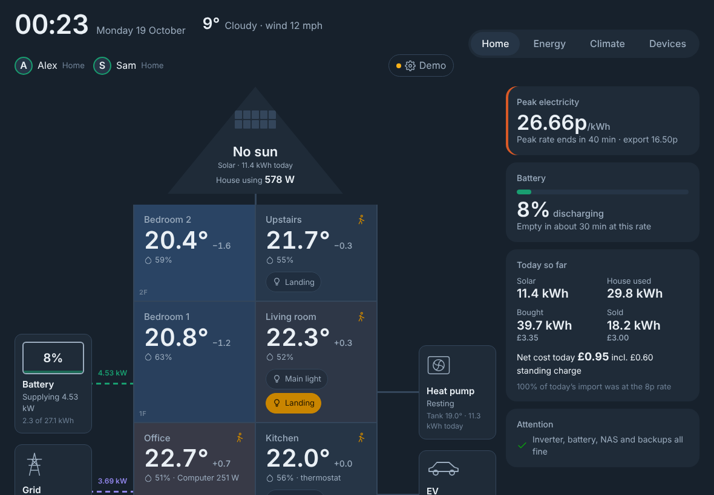

# Panda Dashboard

A wall-tablet dashboard for the house, built on Home Assistant. The house is drawn as a
cross-section — roof panels, three floors of rooms, battery and grid on one side, heat pump
and the EV on the other — with live energy flowing between them. Rooms are tinted by how far
they sit from the 22° comfort target, so heating balance is visible at a glance.



No build step, no framework, no dependencies: plain HTML, CSS and JavaScript talking to
Home Assistant over its WebSocket API.

## Views

| View | What's on it |
|---|---|
| **Home** | House cross-section with room temperature, humidity, presence, lights, AC and TV; weather drawn over the roof; live solar, battery, grid, heat pump and EV flows; battery card; today's kWh and £; front door camera with recent rings; heat pump COP; alerts; shortcuts (lights off, AC, wake/lock/mute/shut down PC) |
| **Rooms** | Floor plan switching between lights/presence (tap a room to switch its lights), temperatures, and the robot vacuum (where it is, rooms being cleaned, live Dreame map, pick rooms; how to clean: vacuum/mop/both, deep clean, CleanGenius, suction, mop wetness, route, passes, more settings); heating balance; 24 h room temperatures; AC: mode, target temperature, room temperature, and on tap fan speed, swing (up/down and left/right), preset, humidity in dry mode and the unit's own switches and selects (display, beeper, vane…) |
| **Energy** | Power through the day with the cheap window shaded; battery charge; 30 days of grid import/export and solar vs use; hot water tank (temperature, heat pump mode and power, 24 h chart); battery plan for the peak hours after the next cheap window; regional grid carbon intensity with the greenest 3 hours |
| **Car** | Car drawing with doors, tyres, charge and climate; charge-now gauge and tonight's plan; spare-solar hint; recent charging sessions with cost and p/mile; 30 days of charging; lifetime and yearly charging totals with cost from the Energy Tracker's tariff history |
| **Devices** | Smart plugs; dishwasher with programme picker; SigenStor hardware; Home Assistant backups and storage; sensor batteries; solar strings (roof vs ground mount, daily and monthly bars, averages, per kWp) |

## Run it

### Option 1 — Home Assistant add-on (recommended)

This repo is a Home Assistant add-on repository. Installed as an add-on, the dashboard gets its
own sidebar entry, sits behind your HA login, and updates from GitHub.

1. **Settings → Add-ons → Add-on Store → ⋮ → Repositories**, add
   `https://github.com/Suchabadpanda/Panda-Dashboard`. While the repo is private, add it as
   `https://<token>@github.com/Suchabadpanda/Panda-Dashboard` using a fine-grained token with
   read-only *Contents* access to this repo.
2. Close the dialog, refresh, and open **Panda Dashboard** in the store. Click **Install**
   (the first build takes a minute or two).
3. Turn on **Start on boot**, **Show in sidebar** and **Auto update**, then **Start**.
4. Open **Panda Dashboard** from the sidebar.

**Updates:** push to `main`. The *Release add-on* GitHub Action bumps the version in
`panda_dashboard/config.yaml` and adds a changelog line. HA picks it up on its next store check
(or **Add-on Store → ⋮ → Check for updates**) and installs it if Auto update is on. Put
`[release]` in a commit message to skip the bump.

### Option 1b — copy into /config/www

`deploy/deploy.ps1` (Samba) or `deploy/deploy.sh` (SSH) copies the app into `/config/www/panda-dashboard`;
open `http://homeassistant.local:8123/local/panda-dashboard/index.html`. No sidebar entry or
auto-update; useful for testing a change before pushing.

### Option 2 — on the NAS with Docker

```bash
cd deploy && docker compose up -d     # http://your-nas.local:8090
```

This is cross-origin, so open **Settings** (the status pill, top right) and enter the HA
address and a long-lived access token (HA → your profile → Security). The token stays in that
browser's local storage. Also allow the origin in `configuration.yaml`:

```yaml
http:
  cors_allowed_origins:
    - http://your-nas.local:8090
```

### Option 3 — demo

Open `panda_dashboard/www/index.html?demo`, or run `python3 tools/build_preview.py` for a single-file
`dist/preview.html`. Demo mode uses a snapshot of the real house taken on 18 Oct 2026
(states, today's power curves, 30 days of daily energy, 24 h of room temperatures). Light toggles
and the vacuum settings work locally in the demo.

### Kiosk tablet

Add `?kiosk` to keep the screen awake (Screen Wake Lock API, needs HTTPS or localhost on some
browsers). On an iPad, *Add to Home Screen* gives a full-screen app.

## Configure

The repo ships an **example** config, [`panda_dashboard/www/js/config.js`](panda_dashboard/www/js/config.js),
that matches the demo snapshot. Your own settings — rooms per floor, entity IDs, names, tariffs —
go in a separate `config.js` that never enters git:

| Running as | Put your `config.js` in |
|---|---|
| Add-on | `\\homeassistant.local\app_configs\<id>_panda_dashboard\` (Samba share add-on 12.10+; older versions call it `addon_configs`) |
| `/config/www` copy | `data\config.js` in your local clone (the deploy scripts copy it) |

Start from a copy of the example file and edit it. It loads after the example and replaces it,
so add-on updates never touch your settings. Reload the dashboard after changing it.

**Tariffs.** With the add-on, edit them in HA under **Settings → Add-ons → Panda Dashboard →
Configuration**. Each row applies from its `from` date until the next row, so add a row when your
rates change each year rather than overwriting the old one — past months keep their old prices.
Rates are £/kWh including VAT (7.6p = `0.076`). These override the tariffs in `config.js`; outside
the add-on, edit `config.js` instead. The Settings dialog (status pill) shows which rates are in use.

**Look.** Settings → Theme and Colours: light/dark/match device, seven colour palettes and an
optional own accent colour, kept per screen. `theme: { mode, palette, accent }` in `config.js` sets
the default for screens nobody has changed.

**Sign conventions** (Sigenergy integration): battery power is positive when charging, grid power
positive when importing.

## Costs and payback

Monthly costs, bills and payback live in the separate
[Energy Tracker](https://github.com/Suchabadpanda/ha-energy-tracker) add-on. The dashboard prices
today and the car's charging hour by hour; the Car page's charging totals use the tracker's tariff
history when it's installed.

`tools/ha_energy_export.py` writes a monthly CSV from Home Assistant's statistics with time-of-use
pricing, for an Excel sheet or other tools:

```bash
pip install websocket-client
HA_TOKEN=... python3 tools/ha_energy_export.py --out energy_monthly.csv
```

## Project layout

```
repository.yaml           marks the repo as an HA add-on repository
panda_dashboard/           the add-on: config.yaml, Dockerfile, nginx.conf, docs, icon
panda_dashboard/www/       the dashboard itself
  index.html              page shell + settings dialog
  css/app.css             all styles; light/dark tokens at the top
  js/config.js            example settings: rooms, entities, tariffs
  js/ha.js                WebSocket client, auth, state store
  js/data.js              history from long-term statistics, refreshed every 5 min
  js/tariff.js            time-of-use pricing
  js/charts.js            small SVG line/bar charts with tooltips
  js/demo.js              demo snapshot of the real house
  js/views/*.js           Home, Rooms (+ plan.js floor plan), Energy, Car, Devices
  js/*.js                 features: doorbell, vacuum, dishwasher, heat pump, sky, Energy Tracker
  vendor/                 Barlow fonts and hls.js (doorbell fallback), so nothing loads from a CDN
.github/workflows/        bumps the add-on version on each change
tools/                monthly CSV exporter, preview bundler
deploy/               HA (bash/PowerShell) and NAS (Docker) deployment
data/                 your config.js for the /config/www copy (ignored by git)
tray/                 Panda Tray, the Windows tray app
```

## Ideas for next

- Room-level heat-pump runtime vs outside temperature, to judge the radiator balancing
- Solar forecast (Solcast / Forecast.Solar) on the power chart
- Sigenergy EVAC charger and the 12 kW inverter's extra MPPTs once installed (list them in `energy.strings`)
- Octopus/EDF tariff comparison using the same hourly import data
